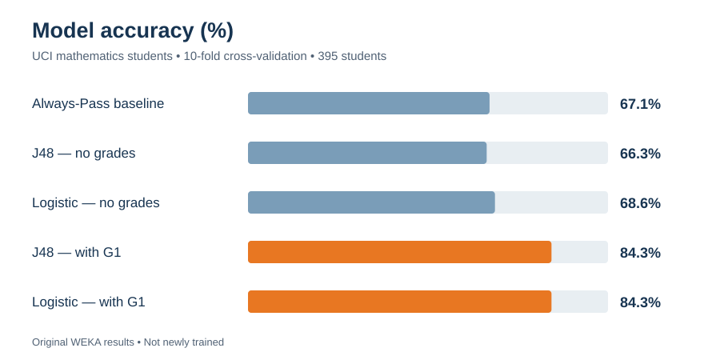
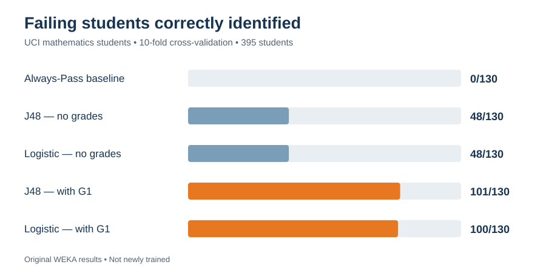

# Predicting Student Academic Success Using Machine Learning

**Konley Stoup & Camden Ball** · Auburn University · COMP 1100 · Fall 2026


> **Question:** Can we predict whether a student will pass or fail a mathematics course from their background characteristics, and how much does knowing their first-period grade (G1) help?
>
> **Answer:** Background characteristics alone barely beat guessing "everyone passes" (68.6% vs. 67.1% accuracy). Adding G1 raised accuracy to **84.3%** and increased the number of failing students correctly identified from **48 of 130 to about 100 of 130**.

**Scope, stated plainly:** this is a two-person classification experiment run in **WEKA's graphical Explorer** with data prepared in **Microsoft Excel**. We did not write model code, and there is no deployed prediction application.

---

## Contents

- [Problem](#problem)
- [Dataset](#dataset)
- [Approach](#approach)
- [Results](#results)
- [Error analysis](#error-analysis)
- [Key findings](#key-findings)
- [Limitations and responsible AI](#limitations-and-responsible-ai)
- [How to reproduce](#how-to-reproduce)
- [Repository structure](#repository-structure)
- [Team](#team)
- [Acknowledgments and citation](#acknowledgments-and-citation)

---

## Problem

Schools want to identify students who may need extra support early enough to help. We framed this as a **binary classification** task:

- **Pass:** final grade G3 ≥ 10 on a 0–20 scale
- **Fail:** G3 < 10

G3 was used **only to create the label**. It was never given to the models as an input.

## Dataset

| Property | Value |
|---|---|
| Source | [UCI Machine Learning Repository: Student Performance](https://archive.ics.uci.edu/dataset/320/student+performance) (Cortez & Silva, 2008) |
| Subset used | Mathematics course |
| Students | 395, from two Portuguese secondary schools |
| Class balance | 265 Pass (67.1%) / 130 Fail (32.9%) |
| Attributes | 30 non-grade attributes (demographic, family, social, and school-related) plus grades G1, G2, G3 |

See [`data/README.md`](data/README.md) for the expected prepared files.

## Approach

**1. Data preparation (Excel).** We created the nominal `PassFail` label from G3, then built two feature sets:

| Feature set | Inputs | Excluded | WEKA attributes |
|---|---|---|---|
| **Without grades** | 30 non-grade attributes | G1, G2, G3 | 31 (incl. class) |
| **With G1** | 30 non-grade attributes + G1 | G2, G3 | 32 (incl. class) |

G2 was excluded from both sets so that the "with G1" model reflects only information available after the first grading period.

**2. Modeling (WEKA 3.8.6).** Two classifiers, each run on both feature sets, for four configurations:

| Classifier | WEKA settings | Why we chose it |
|---|---|---|
| J48 Decision Tree (C4.5) | `-C 0.25 -M 2` (defaults) | Interpretable rules |
| Logistic Regression | `-R 1.0E-8 -M -1` (defaults) | Strong linear baseline with probability outputs |

**3. Evaluation.** 10-fold stratified cross-validation. We compared against an Always-Pass baseline (predict the majority class for every student) and focused on **Fail recall**, since missing a struggling student is the costliest error for this use case.

## Results

All figures below are copied from the team's saved WEKA outputs. Nothing was retrained or recalculated for this repository. The raw values are in [`results/metrics.csv`](results/metrics.csv).

| Configuration | Accuracy | Fail recall | Fail precision | ROC AUC | Failing students identified |
|---|---:|---:|---:|---:|---:|
| Always-Pass baseline | 67.1% | 0.000 | N/A | 0.500 | 0 / 130 |
| J48 — without grades | 66.3% | 0.369 | 0.485 | 0.572 | 48 / 130 |
| Logistic — without grades | 68.6% | 0.369 | 0.533 | 0.672 | 48 / 130 |
| J48 — with G1 | **84.3%** | **0.777** | 0.754 | 0.820 | **101 / 130** |
| Logistic — with G1 | **84.3%** | 0.769 | **0.758** | **0.921** | 100 / 130 |

<p align="center">
  
</p>

<p align="center">
  
</p>

## Error analysis

Confusion matrices from WEKA (rows = actual class, columns = predicted class):

| Configuration | Fail → Fail ✅ | Fail → Pass ❌ (missed) | Pass → Fail ⚠️ (false alarm) | Pass → Pass ✅ |
|---|---:|---:|---:|---:|
| J48 — without grades | 48 | 82 | 51 | 214 |
| Logistic — without grades | 48 | 82 | 42 | 223 |
| J48 — with G1 | 101 | 29 | 33 | 232 |
| Logistic — with G1 | 100 | 30 | 32 | 233 |

A **missed** student (actual Fail predicted as Pass) is the most important error here, because that student would not be flagged for support. Even the best configurations still missed 29–30 of the 130 failing students.

## Key findings

1. **Background attributes alone were weak predictors.** Without grades, J48 (66.3%) was slightly *below* the 67.1% baseline, and Logistic Regression (68.6%) was only slightly above it. Both caught just 48 of 130 failing students.
2. **Early academic performance dominated.** Adding G1 raised accuracy by roughly 16–18 percentage points and roughly doubled the failing students identified (48 → 100–101).
3. **The two algorithms tied on accuracy but differed in ranking quality.** With G1, both reached 84.3% accuracy. J48 caught one more failing student, while Logistic Regression had a much higher ROC AUC (0.921 vs. 0.820), meaning its probability scores separated passing and failing students better.
4. **Accuracy alone was misleading.** The baseline scored 67.1% while identifying zero failing students, which is why we reported Fail recall, precision, and ROC AUC.

## Limitations and responsible AI

**Limitations**

- **Population.** The data covers 395 students at two Portuguese secondary schools. The models are **not validated for American college students** or any other population.
- **Small sample.** With 130 failing students, a difference of one or two students changes recall noticeably. The two "with G1" models should be considered effectively tied.
- **Evaluation design.** Results come from cross-validation on one dataset, with default WEKA settings and no separate held-out test set or hyperparameter tuning.
- **Timing of features.** Some attributes, such as total absences, may not be known at the time of the first grading period, so this is not a validated real-time early-warning system.
- **Prediction, not causation.** The link between G1 and G3 is predictive. It does not show that any intervention would change outcomes.

**Responsible-AI considerations**

- The dataset contains **sensitive attributes** (for example, sex, age, family background, home address type, relationships, and alcohol consumption). Models that use them could reproduce or amplify unfair patterns. We did not perform a fairness audit.
- Any real use would require privacy review, informed consent, fairness testing across student groups, validation on the target population, and **human decision-makers**. A prediction should prompt a conversation and an offer of support, never an automatic consequence.
- False negatives (missed students) and false positives (students wrongly flagged) both carry real costs, and the acceptable balance should be decided by educators, not by the model.

## How to reproduce

1. Download the [UCI Student Performance dataset](https://archive.ics.uci.edu/dataset/320/student+performance) and open the **mathematics** file (`student-mat.csv`, semicolon-separated).
2. In Excel, add a nominal `PassFail` column: `Pass` if G3 ≥ 10, otherwise `Fail`. Convert it to fixed values, then remove G3.
3. Save two CSVs: one without G1/G2/G3, and one with G1 but without G2/G3. Keep all 30 non-grade attributes, including `school`.
4. In WEKA Explorer, load each CSV, set `PassFail` as the class, choose `trees.J48` or `functions.Logistic` with default settings, and run 10-fold cross-validation.
5. Compare your output to [`results/metrics.csv`](results/metrics.csv).

## Repository structure

```
student-performance-prediction/
├── README.md                  Project overview (this file)
├── data/
│   └── README.md              Dataset source and prepared-file descriptions
├── docs/
│   ├── TEAM.md                Team members and contributions
│   └── RESUME_ENTRY.md        Resume wording for the project
└── results/
    ├── metrics.csv            Final metrics for all configurations
    └── charts/
        ├── accuracy.svg
        └── failing_students_identified.svg
```

## Team

This was a collaborative project with an approximately equal division of work.

| Member | Primary focus | Shared work |
|---|---|---|
| **Konley Stoup** | WEKA experiments: classifier setup, model runs, and metrics interpretation | Data preparation, evaluation, final report, poster, presentation |
| **Camden Ball** | Mid-project report documentation and error analysis | Data preparation, evaluation, final report, poster, presentation |

Details are in [`docs/TEAM.md`](docs/TEAM.md).

## Acknowledgments and citation

**Dataset:** P. Cortez and A. Silva. *Using Data Mining to Predict Secondary School Student Performance.* In Proceedings of the 5th Future Business Technology Conference (FUBUTEC 2008), pp. 5–12, Porto, Portugal, 2008. Available from the [UCI Machine Learning Repository](https://archive.ics.uci.edu/dataset/320/student+performance).

**Software:** [WEKA](https://www.cs.waikato.ac.nz/ml/weka/), University of Waikato; Microsoft Excel.

**AI assistance:** The team used ChatGPT and Claude for planning, troubleshooting, explanations, and documentation. All models were trained and evaluated in WEKA by the team, and all reported results come from the team's WEKA outputs.

Completed for COMP 1100 at Auburn University, Fall 2026.
